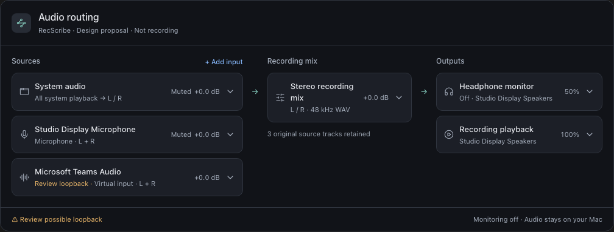
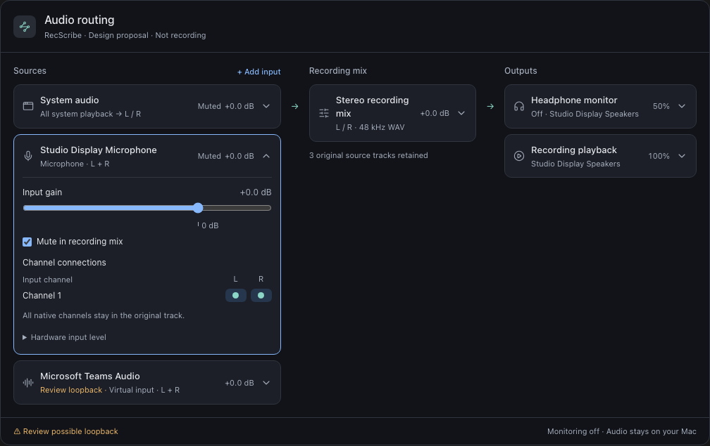
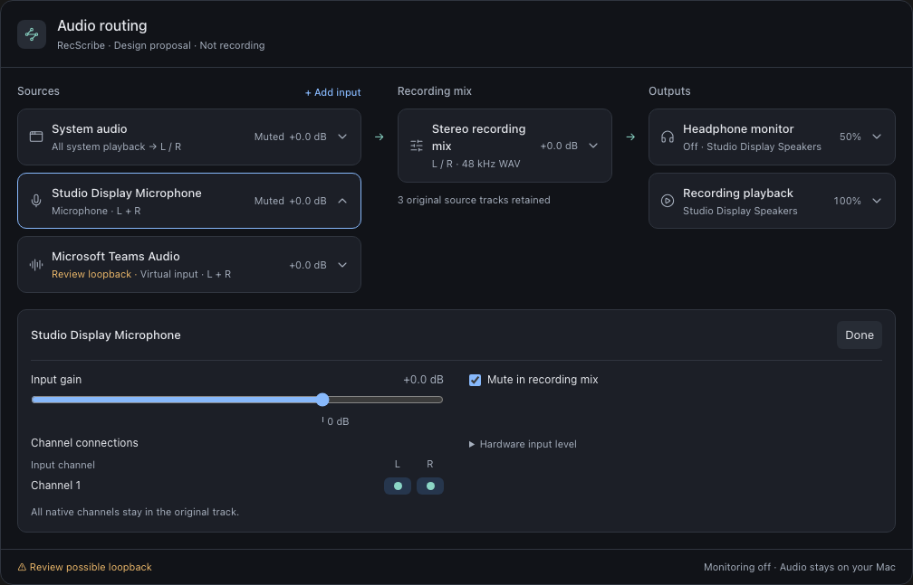
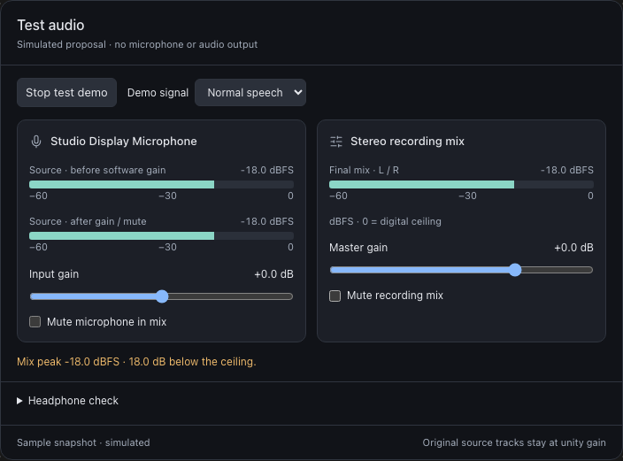

# Audio routing and test-audio proposals

Reviewable design references for the audio tickets. These files simulate controls;
they do not capture a microphone, play audio, change system devices, or implement
the production feature. The original source fragments are retained alongside
standalone exports so the designs can be revised independently of the chat.

## Try the proposals

Download the standalone HTML using GitHub's **Download raw file** action, then
open it in a browser. GitHub's code view does not execute HTML. The exports work
without Codex; the routing export includes navigation between both variants.

- [Compact routing: inline expansion and focused inspector](compact-routing.html)
- [Test audio: simulated signal, gain/mute and peak meters](audio-test.html)

## Compact routing

The default overview retains source names, route summaries, gain/mute state,
output volume/device and monitoring state. Selecting a source, mix or output
reveals its controls; a second selection closes the previous panel. Clicking
the same summary or pressing Escape collapses it. Warnings remain visible.

### Inline expansion

Recommended starting point: controls stay beside the item being adjusted.
Review window sizing and behaviour with large channel counts before choosing.

### Focused inspector

Alternative: the compact graph stays above one shared detail panel. This gives
multichannel interfaces more space, with additional distance between each row
and its controls. The user has not yet selected a final variant.

## Test audio

Proposed production workflow:

1. Explicitly start **Test audio**. Acquire the selected sources using the same
   capture and DSP path as recording, with a preview sink instead of a committed
   session. Opening the routing window alone must never acquire sources.
2. Show each source's pre-gain and post-gain/mute levels plus final L/R mix
   levels, peak hold and clipping/no-data/failure feedback. Keep the overview
   compact; show channel details on expansion.
3. Permit gain/mute changes without restarting capture. Keep source acquisition
   and channel-route changes locked or deliberately stop/restart the test.
4. Offer an explicit **Record a 10-second sample → Play back** action. Pause
   capture and live monitoring before playback to avoid recording that playback.
   Keep/discard the sample explicitly; exclude it from normal library and
   transcription processing unless retained by the user.
5. Optional headphone monitoring uses the existing independent listening
   volume/device and feedback safeguards. An output-device test is an explicit
   action; no automatic tone, system route change or meeting setting change.
6. Stop preview capture on exit, failure, or recording handoff. A real recording
   must never contend with a separate test capture engine.

The mock uses fixed normal/loud/silent sample peaks. It illustrates signal flow,
not actual live metering, output-device verification or complete multichannel
mixing. Its source/master ranges are simplified for interaction. Production
keeps the existing validated gain bounds, ramps and magnetic stops. Peak meters
do not substitute for listening to the saved sample.

## Implementation mapping

| Ticket | Apply this part of the proposal |
| --- | --- |
| #26 | Default compact layout, disclosure/inspector choice, responsive sizing and focus |
| #23 | Shared Sources → Recording mix → Outputs structure and routing entry points |
| #15 | Multiple input summaries, full channel mapping on expansion, visible loopback warnings |
| #17 | Source/master gain, mute scope, pre/post meters and clipping feedback |
| #18 | Separate monitor and saved-playback volume/device, optional listening check |
| #14 | Distinguish raw activity, muted mix, no-data source and saved-file status |
| #16 | Verify browser playback and microphone independently before a meeting take |
| #1 | Source coverage and original-track preservation across capture and preview |
| #13 | Reuse the existing shared playback transport for the short test sample |
| #27 | Explicit live testing, actual meters and short sample capture/playback |

In multi-source mode, remove duplicate detailed **Audio levels** controls from
the main recorder panel after routing reaches parity. Retain compact capture
health/activity and the Audio routing entry point. Preserve single-source
controls until routing can edit those modes without forcing a conversion.

## Failure feedback requirements

The observed missing-microphone case must stay distinct from failed disk writes.
An audio-engine configuration notification alone does not prove physical
disconnect. Report the verified source state and retain successful sources.
When valid WAV parts were finalized but microphone coverage is absent, explain
**"Recording saved; microphone track missing"**, with track-specific review
actions. Reserve save/recovery failure wording for actual save/recovery errors.
Do not label a generic "clipping, timing gaps or incomplete coverage" message as
proof that all three occurred. A transcription draft duration is not the
recording's verified audio duration.

## Validation

Standalone exports checked in a separate headless browser: routing carousel,
single-panel expansion, Escape/Done, simulated mute/gain/clipping, and layouts
at 320 px. No runtime exceptions. Original inline proposals were also checked
at 736 px and routing at 1040 px. Preview images are cropped directly from the
exported product surfaces. No live audio or meeting interaction was used.
