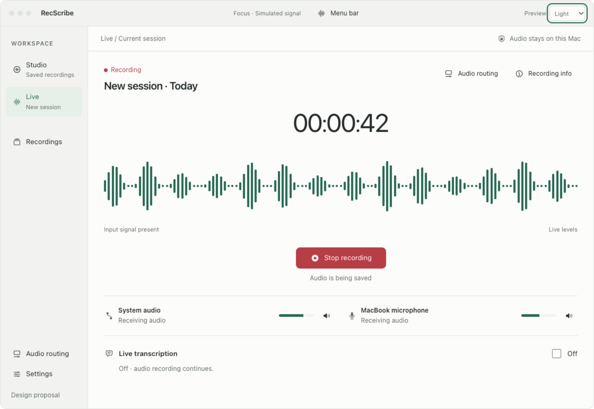
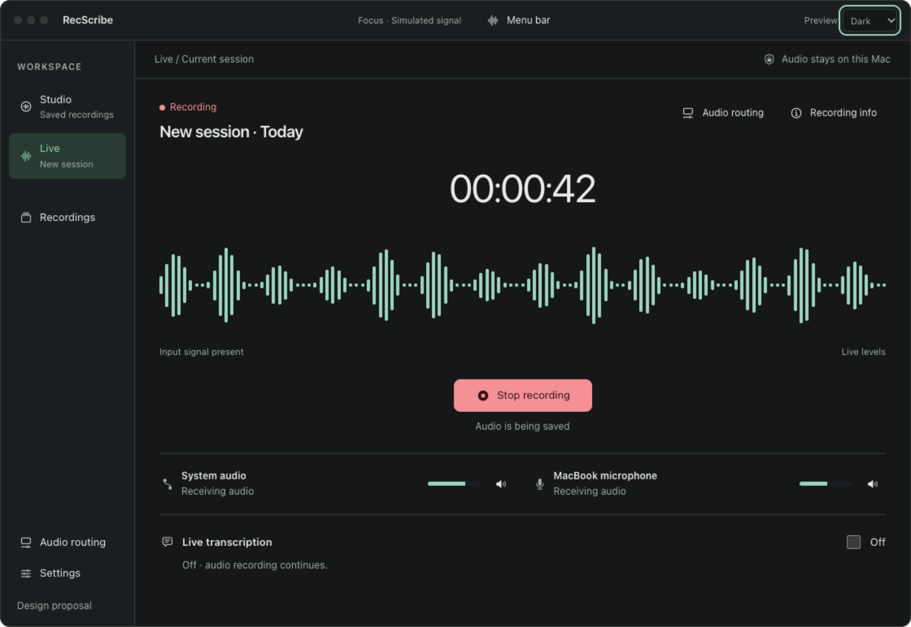
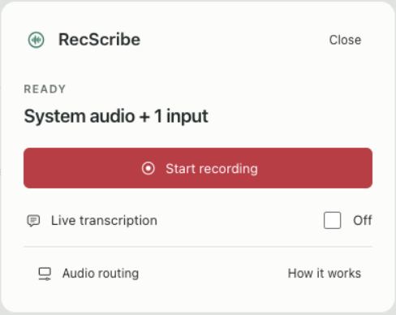
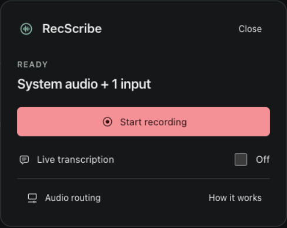
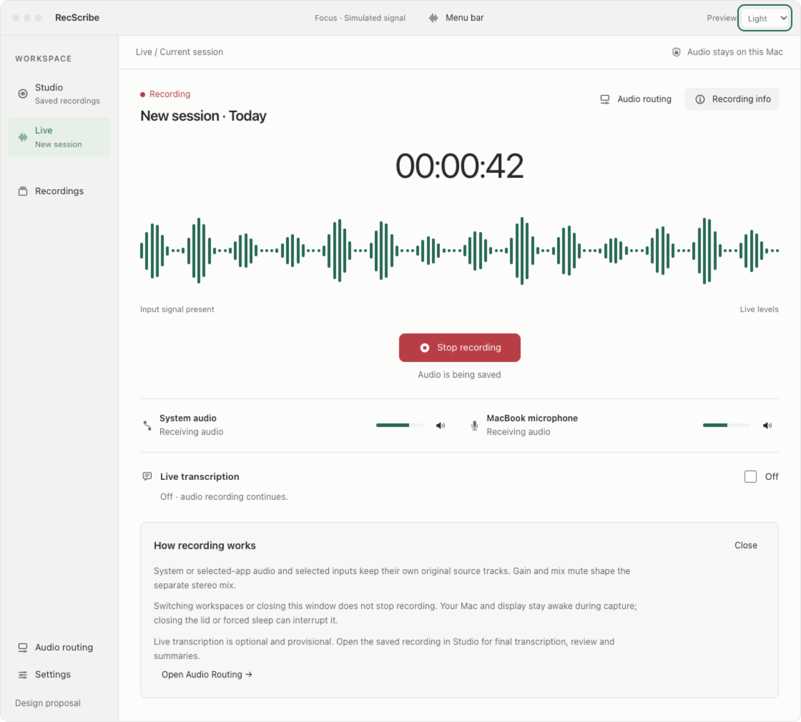
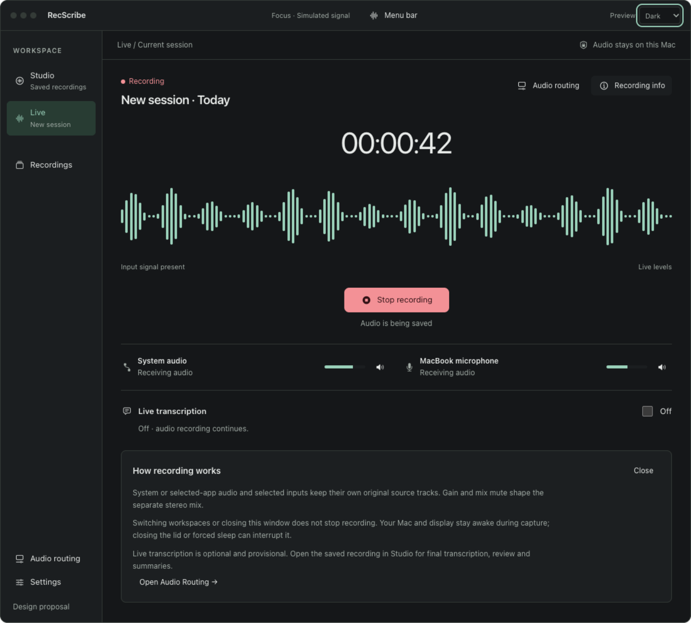
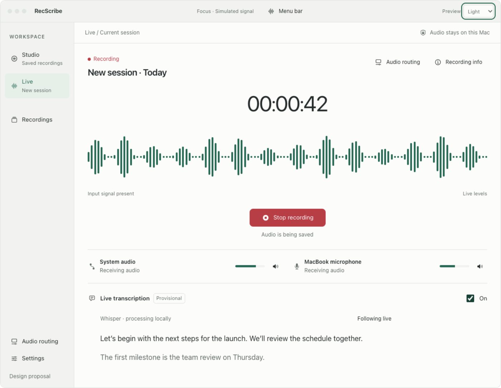
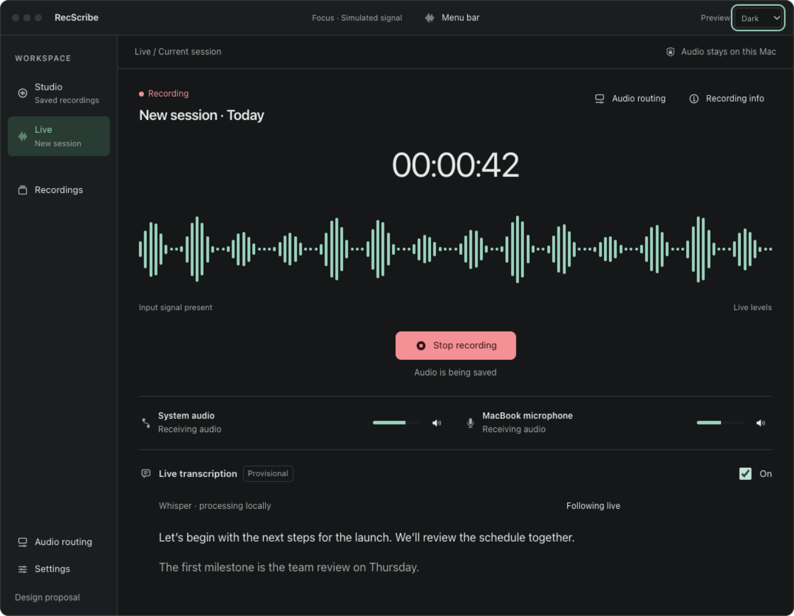

# Focus recording: compact entry, full live pane

Extension to [#99](https://github.com/moreaki/recscribe/issues/99), 5 November 2026.
Adds the **running recording view**, a lightweight menu-bar entry and a deliberate
Start → full Live pane transition to the shared Focus design. Existing Recordings,
Settings, Audio Routing, Studio and both palettes remain in the prototype.

This is a synthetic design reference. It does not capture/play audio, change
permissions or modify the installed app. The initial waveform is a static
illustration of a running session. Explicit Start animates the demo signal;
the chrome labels it as simulated. No user screenshot is republished.

Open [the interactive prototype](recording.html) locally after downloading it.
The initial view shows recording with live transcription **Off**, matching the
requested separation of audio capture from optional transcription. Try Recording
info, the live-text switch, source mix mute and Stop. After New session, open
**Menu bar** and choose Start recording: the compact view closes and the full
Live pane opens immediately, showing Starting before Recording. The appearance
preview retains System / Light / Dark. Host design controls can preview Silence,
No data, Interrupted and Ready without touching native capture.

## Running recording, light and dark

| Light | Dark |
| --- | --- |
|  |  |

The document pane becomes a dedicated capture surface, using the same shell and
restrained palette. It contains:

- Session title and an explicit recording state with red dot + text.
- Large monospaced elapsed time, a wide level-envelope waveform and a short
  input-state caption. These are present even when live transcription is Off.
- One clear Stop recording action and a concise audio-saving state.
- Compact source identity, status, meter and mix-mute actions, with an Audio
  routing entry point for detailed controls. Preserve exact real source selection
  and names in the native implementation.
- An optional Live transcription section. Off takes little space; On opens a
  readable provisional draft with Follow live. It never turns recording off.
- A labeled Recording info action for the optional explanation.

The requested “equalizer” is a level/waveform display, using the existing capture
telemetry, not a new frequency-processing or sound-changing control. Native
implementation should reuse `RecorderWaveformDisplay` / `StudioLiveWaveform`
and the bounded `RecorderWaveformAdapter` behavior. The existing main window
adapter uses 123 display buckets; preserve finite/silence handling and local
high-frequency observation. Do not redraw the transcript or app navigation on
each telemetry update. Moving bars indicate signal activity; successful writing
and capture-health status must still come from the recorder, with errors visible.

## Lightweight menu bar and deliberate expansion

| Light | Dark |
| --- | --- |
|  |  |

Before capture: show the actual source summary, Start recording, the optional
live-text switch and small Audio routing / How it works actions. Remove the
large explanatory block from the default view. Once active, retain Stop, elapsed
time, a small signal cue and Show recording. Native Quit, Settings, recording
library and recovery entry points remain available through their existing menus;
the mock focuses on the recording handoff and does not simulate app termination.

When the user presses Record in the menu bar, bring the existing main window
forward and select its Live recording pane immediately. Show Starting until the
recorder confirms actual capture; do not show an active waveform or a successful
recording claim before that confirmation. Reuse the one existing window and one
recorder service. Duplicate Start clicks, stale callbacks and navigation races
must not create another recording or reset its source identity.

This focus change is tied to the user's explicit Start action. Opening/reopening
windows, restoring a saved UI selection, new level samples, ASR chunks and library
refresh must not steal focus or trigger capture. A saved Studio document remains
selected behind Live and is unchanged when the user returns to Studio.

Closing the full pane or dismissing the menu keeps capture running. The compact
menu and app-wide strip retain Stop / Show Live. Stopping from another workspace
keeps that workspace visible; finalization reports its actual outcome.

Also: [active compact light](menubar-recording-light.png) /
[dark](menubar-recording-dark.png), [starting](recording-starting.png),
[saving](recording-saving.png), [saved light](recording-saved-light.png) /
[dark](recording-saved-dark.png), [ready full pane light](recording-ready-light.png) /
[dark](recording-ready-dark.png).

## Progressive disclosure, without hiding health problems

| Light | Dark |
| --- | --- |
|  |  |

**Recording info** expands a quiet inline explanation; **How it works** does the
same in the compact menu. Both are labeled, keyboard reachable and operable by
click, not hover-only. Default is collapsed; Escape/Close returns focus to the
trigger. Turning live text on/off or opening info does not interrupt capture.

The optional explanation covers original source tracks vs the stereo mix, the
effect of mix gain/mute, source configuration, the optional/provisional live draft,
and the existing sleep/window behavior. Keep exact copy conditional on the active
capture mode; never promise unchanged originals where a single-source mode's
gain/mute affects saved capture.

Keep errors and actionable health states outside this disclosure: missing
permissions, unavailable sources, no received data, clipping, stalled writes,
disk/finalization problems and interrupted/partial recordings. Do not collapse a
failure into an info badge or confuse silent audio with missing input data.

Additional info views: [compact explanation light](menubar-info-light.png) /
[dark](menubar-info-dark.png).

## Optional live text

| Light | Dark |
| --- | --- |
|  |  |

Waveform, timer and Stop stay in the same positions while the draft appears
below. Keep Follow live and the ability to read earlier text. Audio capture and
ASR statuses remain independent: an ASR error is not a successful-audio guarantee
or necessarily an audio-capture failure. Preserve current model/provider consent,
local/cloud labeling, cancellation and worker bounds. The prototype uses one
short synthetic draft, with no recognizer or cloud access.

## State and preservation requirements

| State | Presentation and behavior |
| --- | --- |
| Ready | Actual source summary, zero elapsed time, Start; no invented live activity. |
| Starting | Full Live pane opens immediately; Starting, duplicate-start guard and actual startup/permission errors. |
| Recording + signal | True recording state and elapsed time; actual level history and source health, even when ASR is Off. |
| Recording + silence | Flat/floor signal with Silent, capture remains active. Do not invent words or treat silence as missing data. |
| Recording + no data | Persistent actionable No input data state; retain recorder ownership, recovery and explicit Stop. |
| Stopping/finalizing | Saving recording, transition guard and frozen last signal. No premature saved/success claim. |
| Saved | Successful native finalization confirmed; Open in Studio and New session, with final transcription still explicit. |
| Interrupted/partial | Prominent partial/coverage notice, available audio/evidence retained, explicit review/recovery. No automatic restart or “complete” claim. |

State examples: [silence light](recording-silence-light.png) /
[dark](recording-silence-dark.png), [no data light](recording-no-data-light.png) /
[dark](recording-no-data-dark.png), [partial light](recording-partial-light.png) /
[dark](recording-partial-dark.png), [narrow reflow](recording-narrow.png).

## Native implementation acceptance

- [ ] Explicit menu-bar Record opens/brings forward the one main window in Live,
      with correct starting/recording/failure states. Navigation and app restore
      alone never start a take or repeatedly front the window.
- [ ] Existing Studio recording/job/tab/scroll/inspector context survives this
      transition and asynchronous capture/ASR/library updates.
- [ ] The existing telemetry-driven waveform/timer/source feedback remains live
      with transcription Off, bounded and isolated from document/UI chrome updates.
- [ ] Source names/selection, mix vs originals, actual capture health and local/
      cloud provenance reflect real state; source mute/routing guards remain intact.
- [ ] Explanations default to collapsed and are keyboard/VoiceOver reachable with
      correct open state/focus restoration. Actionable health failures stay visible.
- [ ] Dismissal/closing does not stop recording. Stop and Show recording remain
      available in the menu/strip; existing Quit/finalization behavior is preserved.
- [ ] Finalization, interruption, cancellation, duplicate-start, stale-result and
      window-focus transitions have focused behavior coverage. Preserve raw audio,
      transcripts, worker bounds and required frozen-reference checks.
- [ ] Light/dark/System, current minimum/large windows, longer labels, larger text,
      keyboard/VoiceOver, Reduced Motion and Increased Contrast are reviewed natively.
- [ ] Follow AGENTS.md build/cache/artifact/signed-staging/backup rules when native
      implementation begins. Never replace an app during capture/audio testing or
      change signing identity, entitlements, provisioning or privacy permissions.

## Proposal verification

The focused synthetic harness checks active live-text-off presentation, optional
draft/info and focus, source mix mute, compact menu → full pane Start, distinct
starting/stopping/saved states, bounded animation after explicit Start, preserved
Studio context, silence/no-data/partial views, light/dark and 320–1152 px bounds.
Key rendered screenshots are visually reviewed; browser behavior is not native
capture evidence. The preview uses a bounded 123-bar maximum and throttles demo
animation; hidden-page work stops and reduced motion keeps the waveform static.

```sh
python3 scripts/work-artifacts.py run --label recording-focus-proposal test -- \
  env NODE_PATH=/tmp/recscribe-source-design-tools/node_modules \
  node docs/design-proposals/recording-focus/verify.cjs
```

Reusable source is `recording-fragment.html`; `recording.html` is the portable
preview. Native symbols, including `record.circle`, `stop.circle.fill` and
`info.circle`, are documented by `export-symbols.swift`. Temporary screenshots
belong to the managed run; reviewed copies here are durable proposal assets.

Native implementation, capture/permission/storage tests, accessibility and CI
remain pending. No native source, installed app, real recording or raw transcript
was modified, and no native app build or installation was performed.
