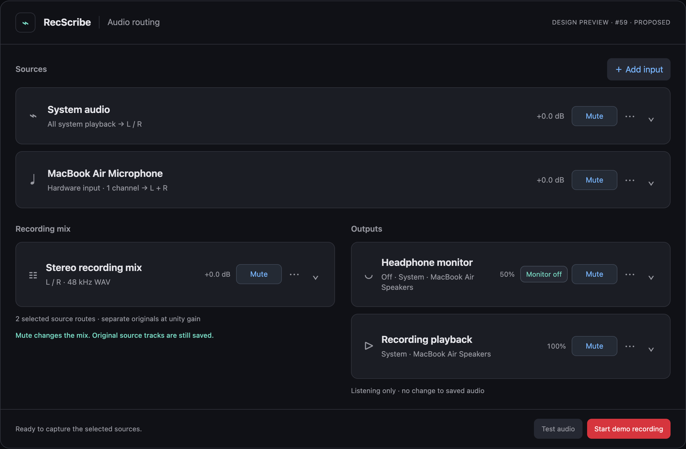
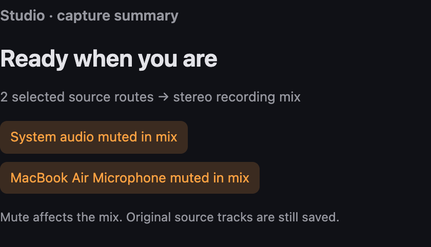

# Routing controls — UI proposal for #59

[Ticket #59](https://github.com/moreaki/recscribe/issues/59) adds discoverable source
removal and directly operable mute controls to the compact routing workspace.
These are interactive design references, not screenshots of an implemented native
feature. Device names, capture state and audio behavior are simulated. The
“Current pattern” view reconstructs the earlier interaction pattern for comparison;
it is not a captured production screen.

## Try the mock

Open [routing-controls.html](routing-controls.html) in a browser. On GitHub, use
**Download raw file**, then open the downloaded file. It is standalone, has no
network dependencies, and does not access devices or play/capture audio.

Switch between **Current pattern** and **Proposed**, then select a scenario.
Try Mute/Unmute without expanding a card, remove/re-add a source, use Undo,
turn monitoring on/off, or simulate a recording to see the edit guards.
Preferences persist in this browser when the file is reopened without a scenario
query; **Reset demo** restores the initial configuration.

## Proposed overview



- **Mute / Unmute** is always available in the card header. The state has a text
  label and accessible pressed state. Muting does not open the card, reset gain,
  remove a source, or enable monitoring.
- **⋯** opens the appropriate actions. Source cards offer **Remove source**.
  The required mix offers **Reset mix settings**; listening outputs offer
  **Reset volume & mute**. There is no pretend Delete action for fixed functions.
- **Monitor on / off** is separate from listening mute. Turning monitoring off
  stops monitoring; unmuting an off monitor does not start it.
- The chevron only opens/closes details. The expanded checkbox and header button
  share the same mute state. Escape dismisses a menu or closes details and returns
  keyboard focus to its trigger.

## Named muted-source summary

The **Named Studio mute summary** scenario lists each selected muted source by
its actual display name: **System audio muted in mix** and **MacBook Air Microphone
muted in mix**. Unmuting/removing a source updates the summary immediately. Master
mix mute remains a separate message; output mute is not reported as a muted
capture source. The summary wraps long names instead of substituting a count.



## States for review

| State | Preview | Decision illustrated |
| --- | --- | --- |
| Earlier interaction pattern | [Before](before.png) | A passive mute badge alone is insufficient |
| Studio summary | [Named muted sources](studio-summary.png) | Concrete source names instead of “Playback” / “1 input” |
| Muted, collapsed | [Mute / Unmute](muted.png) | One click restores sound without expanding |
| Expanded input | [Shared mute state](expanded.png) | Header and expanded controls stay synchronized |
| Source actions | [Remove source](remove-source.png) | Discoverable removal, preserving saved recordings |
| Required mix | [Mix actions](fixed-mix.png) | Reset instead of deleting a fixed pipeline stage |
| No sources | [Empty configuration](empty.png) | Record/Test disabled; no automatic source fallback |
| Missing device | [Unavailable input](unavailable.png) | An unavailable configured source remains removable |
| Recording | [Capture guard](recording.png) | Source removal locked; live mute remains available |
| Narrow window | [Narrow layout](narrow.png) | Controls wrap without clipping or horizontal overflow |

The empty configuration is the preferred #59 proposal; the ticket's alternative
of explaining why the last source cannot be removed remains an implementation
decision if the capture model requires it. The mock does not introduce source-only
recording or additional output buses.

## Validation

The PNGs are rendered directly from the standalone mock in headless Chrome at
2× scale. Browser checks cover mute/disclosure synchronization, source removal
and Undo, re-add/persistence, empty-state guards, missing-device removal, fixed
mix actions, recording edit guards, and monitor/mute independence. All passed,
with no browser runtime errors. Layouts at 320, 390 and 760 CSS pixels were checked
for document overflow and controls extending beyond card bounds. Desktop previews
use a 1280-pixel viewport. Screenshots were visually inspected; the first narrow
layout was corrected so chevrons remain inside card padding.

To reproduce, install Playwright outside the repository and run:

```bash
npm install --prefix /tmp/recscribe-mock-tools playwright
NODE_PATH=/tmp/recscribe-mock-tools/node_modules \
CHROME_PATH='/Applications/Google Chrome.app/Contents/MacOS/Google Chrome' \
node docs/design-proposals/routing-controls-59/verify.cjs
```

`CHROME_PATH` is optional when Playwright's own Chromium is installed. The harness
regenerates the PNGs beside the mock. These checks do not verify native SwiftUI,
VoiceOver, real capture, physical-device routing or saved audio. #59 stays open
until the production behavior is implemented and verified.
