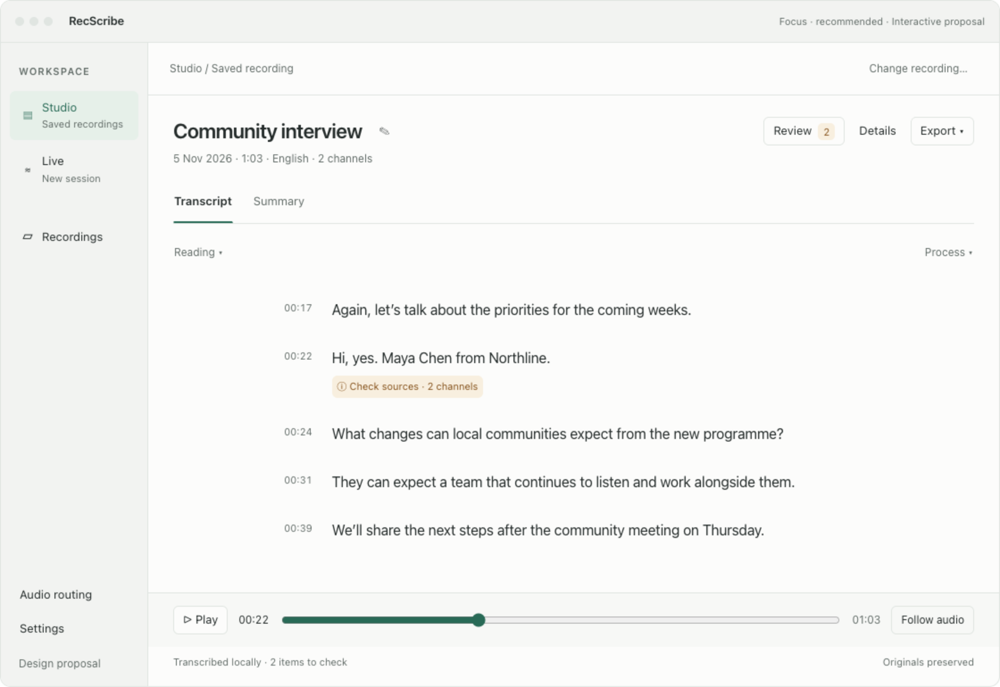
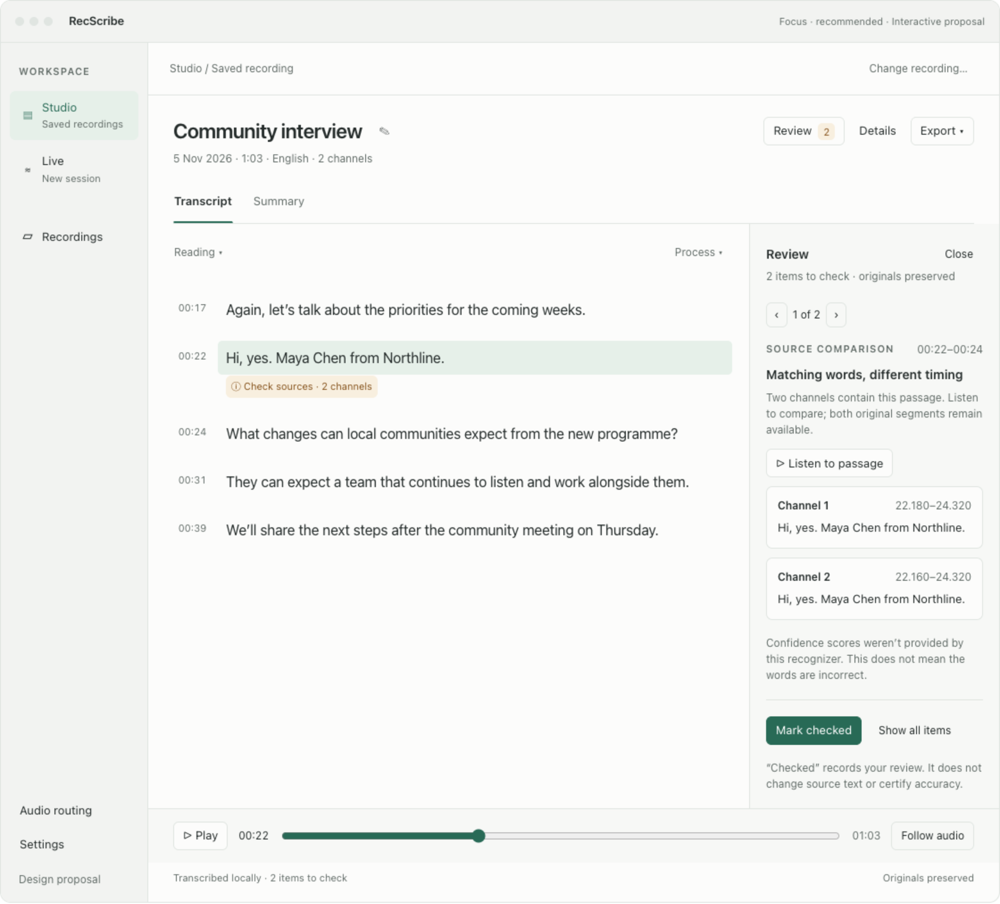
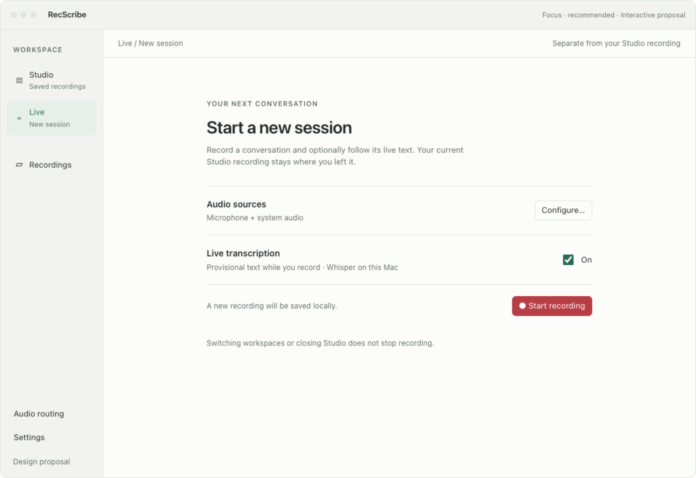
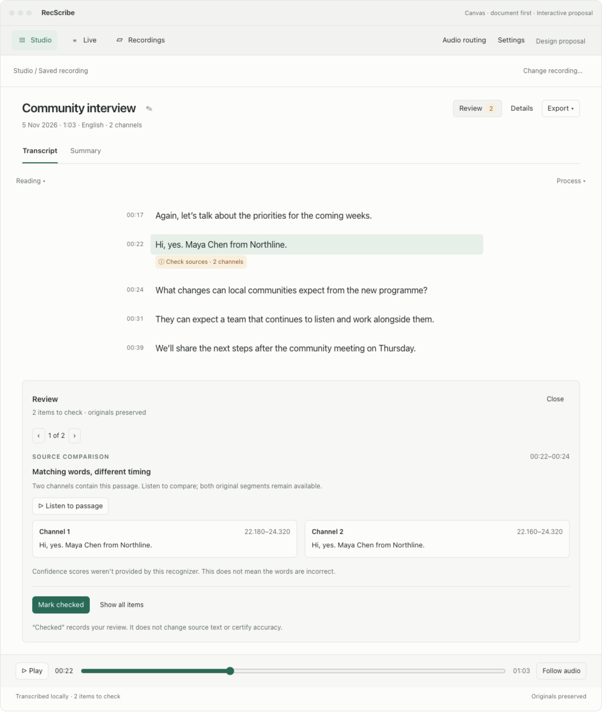

# Studio revamp: calm documents, independent Live sessions

Design proposal, 5 November 2026. These are interactive browser mocks with synthetic
content, not an implemented native feature. Recording, playback, processing,
settings, sharing and export are simulated; no microphone, files, cloud provider
or real transcript is accessed. The user's screenshot is not published here.

## Recommendation and alternatives

**Focus** is recommended: a small workspace sidebar, a generous document column,
and one optional inspector for Review or Details. Studio means working with a
saved recording; Live means a new/current capture session. Recordings is the
library from which a document is opened. Audio routing and Settings remain
utilities. The large permanent capture rail leaves Studio and belongs in Live.

**Canvas** uses app-level navigation across the top and a centered document. Review
opens below the document with channel comparisons side by side. It gives writing
more width but requires more vertical travel between a passage and its evidence.
Focus better supports repeated source checking and clearer workspace orientation.
At compact widths its inspector becomes a sheet in the native implementation;
the browser prototype stacks it below the document to keep every control visible.

Both directions replace the four mixed-purpose tabs with two document tabs,
Transcript and Summary. Review is a tool with a count; Details is an explicit
inspector action. Live is always at the application navigation level.

Open [the interactive prototype](studio.html) locally; use the bottom variant
picker to compare Focus and Canvas. On GitHub, download the HTML first. The
generated preview embeds its styling and interaction runtime. Try **Check sources**,
Review, Details, source playback, Summary source links, Process and Export, then
Live → Start → Studio → Show Live → Stop → Open in Studio. Reading size and measure
can also be adjusted through design controls when supported by the conversation.






Additional states: [Details](focus-details.png), [processing note](focus-processing-note.png),
[Summary](focus-summary.png), [Live recording](live-recording.png),
[recording while browsing Studio](studio-while-recording.png), [saved Live session](live-saved.png),
[explicit final-transcript handoff](studio-handoff.png), [dark appearance](focus-review-dark.png),
[compact layout](focus-review-compact.png), [narrow reflow](focus-review-narrow.png).

## What the current code explains

Inspected local revision `ffa13c62d3c386c80668b149f7dfd926b11b4b42`. The relevant
Studio, transcript and reading files match inspected `origin/main` (`c6080ee`).
This is source inspection and the supplied image, not a reproduction in the
installed native app.

- `StudioView.swift` mounts capture and live controls beside every workspace.
  `TranscriptWorkspace.Section` mixes Live with Transcript, Summary and Review.
- `TranscriptReadingView.swift` renders the circled exclamation mark and “Review”
  together as a **Label**, not a Button. The apparent info control has no handler.
  Sources & review opens a disclosure, and raw reason identifiers are printed.
- The Review tab does switch content, but `TranscriptPreview.reviewPlainText`
  derives only from top-level `payload.reviewReasons`; segment-level reasons and
  overlap evidence do not populate a navigable review queue. It can be empty while
  passages still display review flags. Verify affected real jobs before calling
  this a reproduced runtime defect.
- `TranscriptReading.Group.isShared` deliberately requires exact text **and**
  exact timing. In the screenshot the words match, but start times differ by
  20 ms, so both full variants are exposed. This is evidence preservation working
  through an unnecessarily noisy presentation, not a reason to delete a segment.
- `TranscriptWorkspace` reacts to a new live source by clearing the selected job
  and switching to Live. Its current navigation state couples independent tasks.
- The footer always says “review required”, even when an actionable list is
  absent. Pipeline strings, model filenames and implementation reasons occupy
  the reading surface.

## Proposed information architecture and state ownership

| Destination | User intent | Owns | Primary next action |
| --- | --- | --- | --- |
| Studio | Work with saved audio | Recording/job ID, document tab, passage, playback and inspector | Read, check, summarize or export |
| Live | Capture a new/current conversation | Active capture ID, sources, draft, follow mode and capture status | Start/stop a session |
| Recordings | Find/manage saved recordings | Library selection and existing row/bulk actions | Open in Studio |
| Audio routing | Configure sources and listening | Existing routing model and capture/test locks | Return to originating workspace |
| Settings | Configure processing and app preferences | Existing preferences and provider consent | Return without losing context |

Studio selection and Live session identity must be independent. Starting capture,
finishing a chunk, refreshing the library or stopping capture must never replace
the document being read. Explicitly opening a recording or choosing **Open in
Studio** changes Studio's selection. Keep per-recording scroll/playback/review
context; preserve existing menu-bar capture access and window-closing behavior.

While capture is active, show a compact app-wide strip with **Recording**, its
own session title, elapsed time, **Stop** and **Show Live**. Do not imply that the
saved recording visible underneath is being recorded again. Navigation cannot
stop capture. Preserve the existing processing/playback safety gates and explain
why an action is unavailable. This is navigation work, not a second capture engine.

Live is independent of *previous* recordings. The current audio-backed live
architecture still saves a new recording. This proposal does not add an unsaved
listen-only mode, route an old recording through live capture, or silently enable
transcription. Any future listen-only product would need its own retention design.

## Studio surface and complete action mapping

| Current element | Proposed treatment and behavior |
| --- | --- |
| Generic “Your words, in focus” heading | Use the editable recording title, one date/duration/language/channel line, and a Studio / Saved recording context cue. Rename remains explicit. |
| Copy Markdown, Copy Plain Text, Share | One labeled Export menu. Preserve all formats and source/provenance markers; operate on the selected document. Confirm copy success/failure. |
| Live / Transcript / Summary / Review tabs | App-level Live; local Transcript / Summary tabs; Review opens an inspector with a truthful count. |
| Repeated filename/model/processor strings | Details inspector with source identity, processing history, model, language, paths and reveal actions. Technical diagnostics stay expandable and copyable. |
| Play / Reveal | A stable bottom transport for Play/Pause, seek and Follow audio; Reveal in Details or More. Keep source-unavailable and playback failure messages actionable. |
| Transcribe again / Improve text / settings | A labeled Process menu. Existing confirmation/configuration flows remain; expose Create transcript or Generate summary as the primary action in their empty states. |
| Reading / All channels tab row | Compact view selector. Reading emphasizes paragraphs; All channels exposes every original segment. Never infer speaker names from channel numbers. |
| Full timestamp ranges on every block | Short clickable start times in a quiet gutter. Exact millisecond ranges remain in source details and exports. Seeking retains source identity and existing safety guards. |
| “Review” and circled warning label | One real **Check sources** button with an accessible description, opening the relevant issue and highlighting the passage. No icon-only nonfunctional pseudo-control. |
| Repeated expanded source disclosures | Readable text first, one evidence entry point. Matching words with timing differences get a visible 2-source cue; preserve both exact source ranges. |
| Raw `confidence_unavailable` | “Confidence scores weren’t provided by this recognizer.” Group repeated run-level notes; do not invent a score or treat missing confidence as proof of a bad sentence. |
| Raw `translate_processor_not_configured` | “Translation was not run”, scope it to the affected run and offer Set up translation. Show original recognized text and a truthful fallback state. |
| Unconditional review-required footer | Actual unresolved item count or “All review items checked”. Keep processing provenance separate from manual review. |
| Pipeline/activity/debug controls | One concise operation status with progress, Cancel and recoverable failure; detailed logs/artifacts in Details/More. |
| Open transcript / Artifacts / Delete transcript | Preserve Open transcript… through the library/Studio menu, Artifacts through Details/More, and Delete transcript… through More with the existing Trash confirmation and guards. |

The synthetic export/process/routing/settings interactions demonstrate entry
points and feedback, not full native dialogs or a redesigned audio-routing page.
Coordinate the Recordings handoff with [#94](https://github.com/moreaki/recscribe/issues/94);
its selection and deletion proposal remains separately scoped.

## Actionable Review and Details

Build one bounded review projection from document reasons, segment reasons,
`needsReview` flags, channel alternatives and recording/source-coverage notes.
Carry recording/job/revision identity and exact segment IDs. A flagged segment
with no reason must still produce a useful “Check this passage” item. An unknown
reason becomes “Additional processing note”, with the original code under
Technical details. Do not silently drop a flag because no friendly mapping exists.

Count **unique review tasks**, not raw repeated strings or channels. Merge only
equivalent reasons with the same scope; retain references to every affected
segment. Whole-recording configuration notes and individual passage issues stay
distinguishable. The mock's count of two is synthetic: one channel comparison
and one processing note. Define this aggregation explicitly before implementation;
changing severity or removing a required review flag is outside a layout refactor.

Review opens at the selected passage, or the first unchecked task. Previous/Next
navigates tasks, shows an exact position, scrolls/highlights the matching passage,
and offers source playback. Whole-recording items explain their scope. Missing
audio disables listening with a reason; evidence remains readable. Details opens
in the same inspector location, with a visible selected/open state. Escape/Close
returns focus to the trigger that opened it. Opening an inspector never starts audio.

“Mark checked” records the user's acknowledgement; it does not correct the model,
alter original evidence, certify accuracy or mark a skipped translation successful.
Store acknowledgements separately, atomically, keyed to job/revision + reason
scope + stable segment IDs; support reopening and read failures. Changed evidence
invalidates the affected acknowledgement. “All review items checked” must never
mean “error-free” or clear canonical `needsReview`/raw reasons. Exports must retain
existing review evidence until an explicit export policy is agreed.

Equal display strings with different source text/processing provenance must not
be collapsed as equivalent. Identical original/displayed words with timing-only
differences can share a *display paragraph* if both ranges, source count and
review entry point remain visible. Different wording stays a visible comparison;
never choose an authoritative channel automatically or throw away either variant.
No canonical/grouping/renderer policy changes are required just to add the inspector.

## Live guidance and edge states

| State | Visible cue and available next step |
| --- | --- |
| Ready | “Start a new session”, source summary/configure, explicit optional live text switch, local-save explanation, Start recording. No old recording title in this view. |
| Starting | “Starting recording…”; prevent duplicate Start. Keep real source/permission errors distinct. |
| Recording | Session title, timer, existing level/waveform signal feedback and source/mute status, Stop, live draft and its provisional label. Keep meters local to avoid transcript redraws. |
| Live text off | Clear Off status; audio continues. Final transcription remains available after stop. |
| Model missing / ASR failed | Actionable setup/retry for transcription. Clearly say whether audio capture is continuing. No silent model download/cloud fallback. |
| Draft lag / no words yet | Distinguish waiting for audio, verified silence, processing and backlog using actual available telemetry. Preserve Follow live and the ability to read earlier text. |
| Stopping / tail drain | “Saving recording…” and independent draft-finishing state; no successful-save claim until finalization succeeds. Existing new-capture priority remains. |
| Saved | “Recording saved”, explicit Open in Studio and New session; keep live draft provisional. Opening Studio offers Create final transcript, never an old recording's transcript under a new title. |
| Interrupted / partial | Persistent partial-recording notice, source/coverage notes and recovery path. Do not label it complete or automatically restart. |
| Browsing Studio during capture | App-wide recording strip names the Live session. Saved document/context stays intact. Existing action guards explain unavailability. |
| Window reopened | Restore Studio document and independently expose real active capture status. Never resume capture because of restored UI state. |

The prototype demonstrates ready, live on/off, recording, saved and explicit final
transcript handoff. Meters, follow-live scrolling, errors, interruptions, provider
consent dialogs and asynchronous drain are specified above but are not simulated.

## Visual and interaction system

Native macOS typography and SF Symbols in the implementation; 23 px title,
16–18 px readable body, 12–13 px controls/metadata at normal scale. Use dynamic
text scaling; avoid long all-caps UI labels. Work from the existing Studio tokens
and semantic colors rather than adding a parallel theme engine. 8-point spacing,
approximately 600–700 px reading measure, subtle separators and very few cards.
One restrained mint selection/action accent; amber only for attention; recording
retains red plus a text label. Light/dark, Increased Contrast and Reduce Motion
must remain supported. Avoid decorative animation and large glass layers over text.

Primary actions depend on state: Start/Stop in Live, Create transcript in an
unprocessed Studio recording, Generate summary in an empty Summary, Mark checked
inside Review. Export, Details and Process remain calm secondary controls.
Keep all actions keyboard/VoiceOver accessible without hover. Use native menus,
tab semantics, focus restoration, localized labels and meaningful disabled reasons.
At the current native minimum window size, use a resizable/collapsible sidebar
and sheet inspector before squeezing the document. The 320 px browser reflow is
an artifact accessibility check, not a proposal to change macOS minimum size.

This use of application navigation and contextual controls is informed by Apple's
[Sidebars](https://developer.apple.com/design/human-interface-guidelines/sidebars),
[Toolbars](https://developer.apple.com/design/human-interface-guidelines/toolbars)
and [Layout](https://developer.apple.com/design/human-interface-guidelines/layout)
guidance. Focus and Canvas are RecScribe-specific design judgments, not an Apple
prescription or a claim of accessibility compliance.

## Delivery slices and acceptance

1. **Review/info functionality:** bounded reason projection, plain-language mapping,
   real passage actions, Details inspector and truthful counts. Ship a small usable
   native candidate for manual review; leave acknowledgement UI out until durable
   scoped persistence is correct.
2. **Studio calmness:** recording-title header, action consolidation, reading gutter,
   two document tabs, full capability mapping and source-linked Summary. Reuse the
   current grouping/evidence contracts first; separately validate any display sharing.
3. **Independent Live navigation:** separate Studio and capture state, move capture
   setup, add global recording strip and explicit saved-session handoff. Preserve
   the recorder/service lifecycle and all existing cancellation/source guards.
4. **Review acknowledgement and finishing:** revision-bound check/reopen storage,
   compact layouts, native keyboard/VoiceOver, restoration and long-document behavior.

- [ ] Each apparent Review/info control performs an accessible, visible action;
      any warning in the reader is reachable from Review with correct scope/count.
- [ ] Raw flags stay discoverable in Details; friendly text does not conceal unknown
      reasons, missing confidence, skipped translation or contradictory source words.
- [ ] Existing playback, seek, formats, share, processing, consent, source/job opening,
      artifacts, rename, recovery and delete behavior remains available.
- [ ] Starting/stopping Live, new chunks and library refresh preserve the saved
      Studio selection, reading position and inspector; every handoff uses exact IDs.
- [ ] A new Live session never inherits old audio/transcript content. Final creation
      and summary remain explicit; interrupted/partial output is never called complete.
- [ ] Review check/reopen is durable, job/revision scoped, atomic and failure-aware,
      with stale acknowledgement invalidation and unchanged canonical/raw evidence.
- [ ] Native manual review covers two-channel timing-only matches, differing words,
      empty/global/segment/unknown reasons, missing audio, no recording, no transcript,
      no summary, busy/cancel/error, active capture, interrupted draft and cloud consent.
- [ ] Native layout/keyboard/VoiceOver review covers current minimum and large windows,
      long names/localization, larger text, light/dark, Increased Contrast and Reduce Motion.
- [ ] Focused behavior checks cover review aggregation/identity, stale UI work,
      independent navigation, source seeking, check persistence and Live handoff.
      Run required frozen-reference checks at the appropriate implementation stage;
      preserve source hashes and never rebaseline reference fixtures for a pass.
- [ ] Follow AGENTS.md: existing build cache, managed disposable outputs, signed staged
      app, recoverable installed-app backup and no active recording/audio test at install.
      Keep identity/team/entitlements/privacy permissions. A small UI candidate should
      reach manual review before broad tests; changes to state/storage/concurrency need
      their justified correctness checks. Required CI/merge gates still apply.

## Proposal verification and limits

Synthetic prototype checks passed on 5 November 2026: Review/Details and technical
disclosure; count/check/reopen; source seek and Summary links; channel presentation;
simulated export feedback; independent Live lifecycle with live text on/off;
retained Studio selection; recording guard; explicit unprocessed Studio handoff.
Checked bounds at 320/360/620/760/940/1024/1152 px, both alternatives, light/dark
rendering, with no script errors. Key PNG states were visually inspected.

```sh
python3 scripts/work-artifacts.py run --label studio-revamp-proposal test -- \
  env NODE_PATH=/tmp/recscribe-source-design-tools/node_modules \
  node docs/design-proposals/studio-revamp/verify.cjs
```

`verify.cjs` needs Playwright and local Chrome (override `CHROME_PATH` as needed).
Screenshots go to `RECSCRIBE_RUN_DIR`; reviewed copies here are durable design assets.
Regenerate `studio.html` from `studio-fragment.html` using the visualization renderer;
the fragment is the editable source. Review statuses are local mock state, not a
native schema. No app source, installed app, recordings or transcripts were changed.
Native implementation, native behavior/accessibility and CI remain pending; no
native suite, build or installation was run for this design-only proposal.
