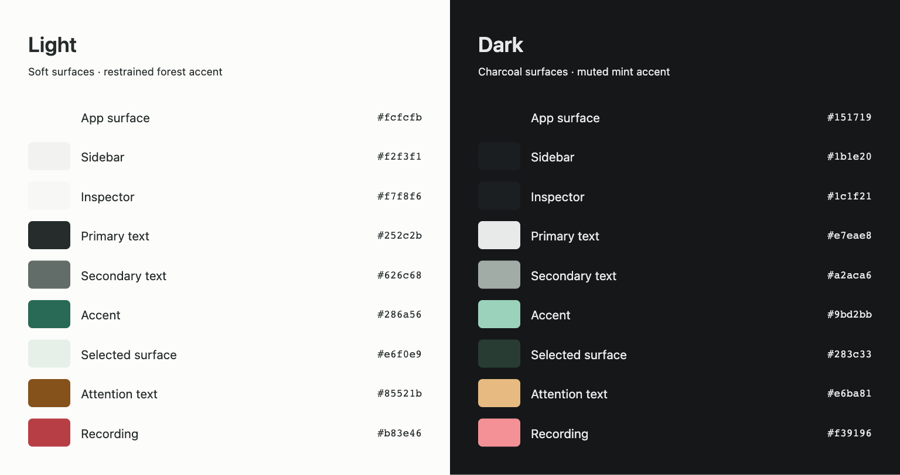
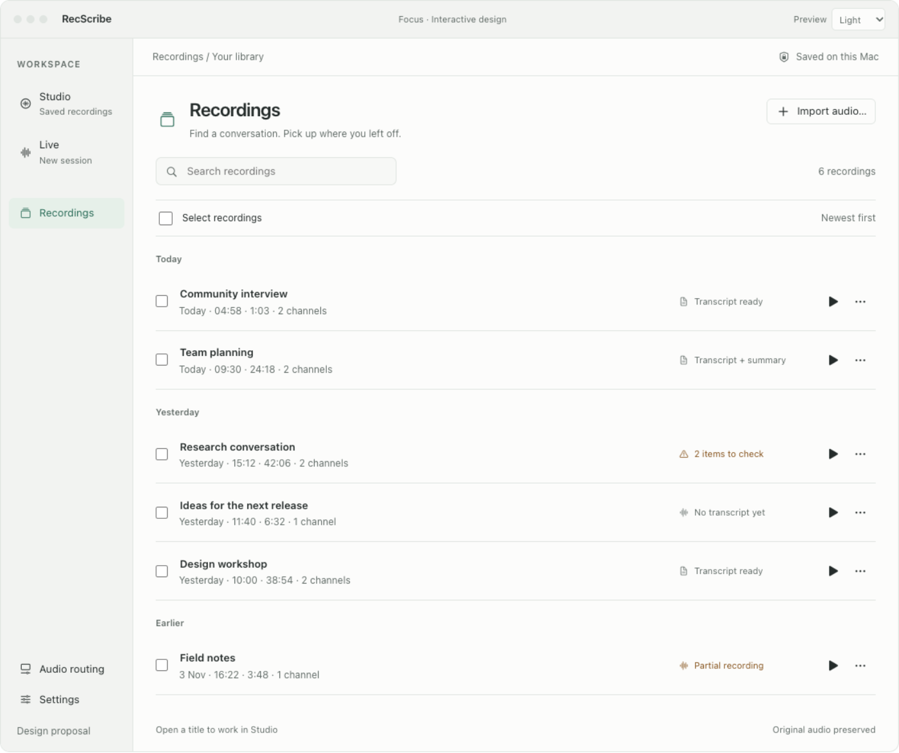
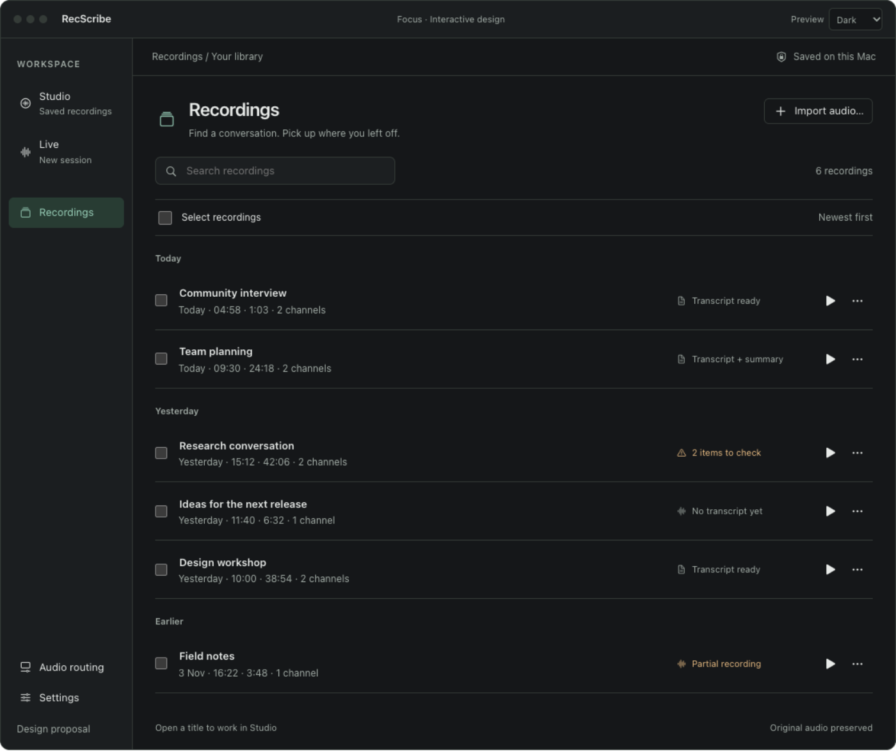
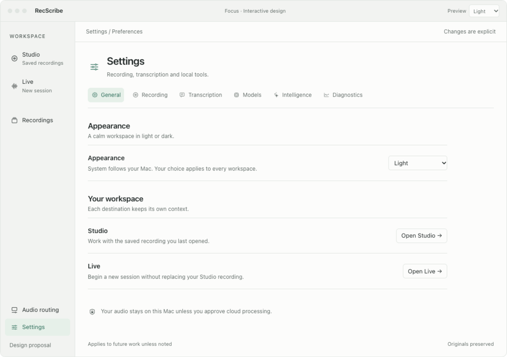
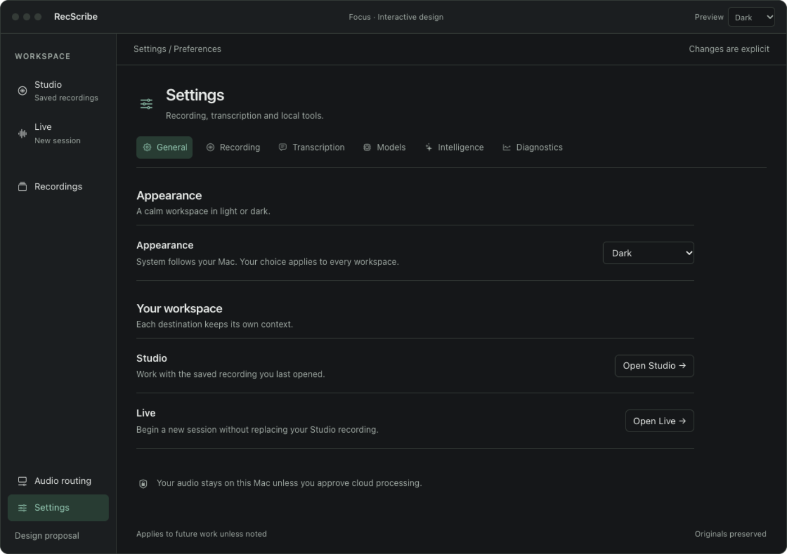
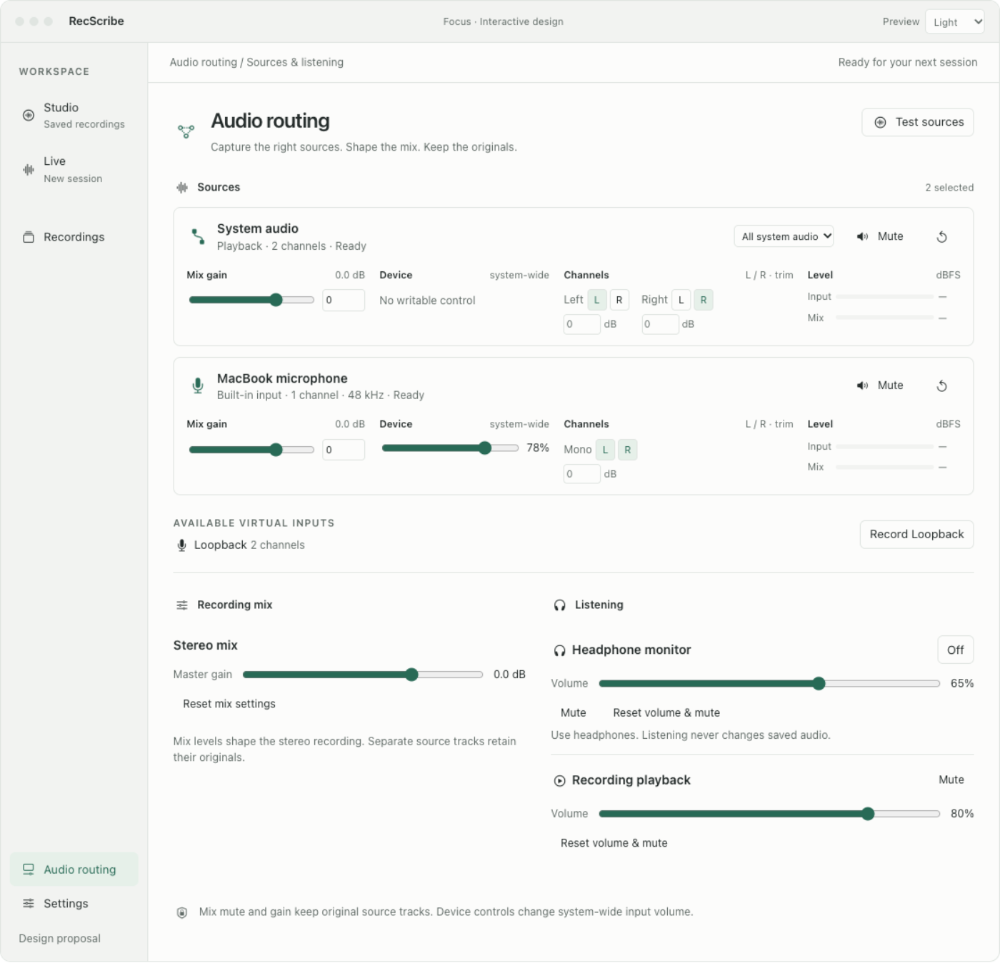
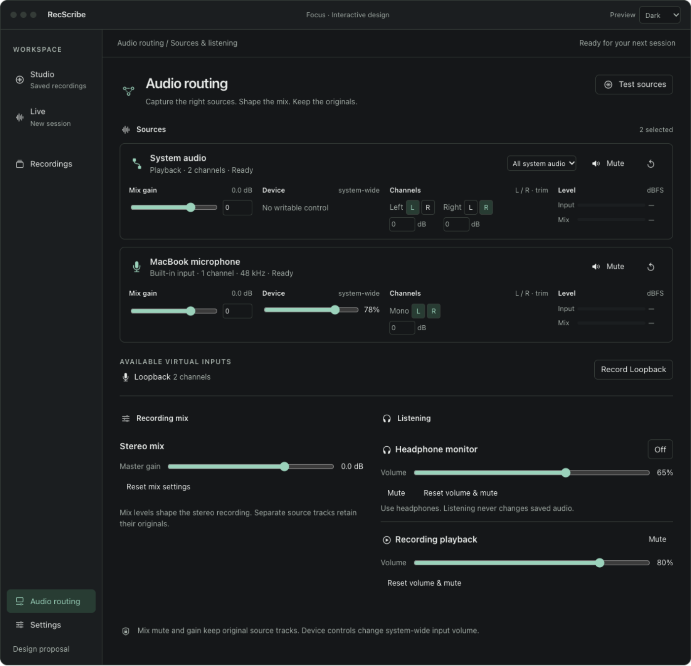

# Focus across the RecScribe workspace

Design extension for [#99](https://github.com/moreaki/recscribe/issues/99),
5 November 2026. Extends the chosen Focus direction to **Recordings, all Settings
sections and Audio Routing**, with a consistent light/dark palette and the app's
existing pane and audio SF Symbols. Studio and Live remain in the same interactive
shell. This proposal does not implement native application changes.

Open [the interactive design](workspaces.html) after downloading the HTML.
Use the sidebar to explore each workspace. **Preview → System / Light / Dark**
changes the entire mock without changing its selection or controls. This preview
shortcut is an evaluation aid; the proposed native preference lives in Settings
→ General → Appearance. System is the default and follows macOS appearance.

All names, model availability, source telemetry, job counts and transcript data
are synthetic. No devices, recordings, Keychain entries, network services or
native preferences are accessed. File/system workflows show a handoff or feedback
instead of executing those operations. The prior Studio source-evidence and
independent Live-session requirements still apply.

## Light and dark, side by side



| Token | Light | Dark |
| --- | --- | --- |
| App surface | `#fcfcfb` | `#151719` |
| Sidebar | `#f2f3f1` | `#1b1e20` |
| Inspector | `#f7f8f6` | `#1c1f21` |
| Primary text | `#252c2b` | `#e7eae8` |
| Secondary text | `#626c68` | `#a2aca6` |
| Separator/control border | `#e0e5e1` | `#343b37` |
| Primary accent | `#286a56` | `#9bd2bb` |
| Selected surface | `#e6f0e9` | `#283c33` |
| Attention text/surface | `#85521b` / `#f8efdf` | `#e6ba81` / `#3b3124` |
| Recording | `#b83e46` | `#f39196` |

These are mock reference values, not a mandate to duplicate native semantic
colors with literal hex values. Implement through the existing Studio theme
tokens and native increased-contrast behavior. Accent tint is restrained; only
attention and recording carry status colors, always paired with text. Keep
disabled controls, focused states, icons, meters and sheets theme-aware too.

## Recordings

| Light | Dark |
| --- | --- |
|  |  |

Use compact, date-grouped rows: persistent selection checkbox, editable title
entry point, one time/duration/channel line, a concise transcript/review state,
Play and More. Open a title to work in Studio; Play stays in the library. More
opens recording details and existing secondary actions. Search filters the
displayed library without destroying Studio context.

Selection changes the toolbar to a clear count, Clear and Delete N. The master
checkbox selects all **shown** recordings, including offscreen rows in a native
virtualized list. A filtered result set is the explicit selection scope; hidden
selected items must remain counted, visible as a scope note, and listed in the
confirmation. The mock retains selections when filtering. Preserve native range
selection; Cmd+A works within the list without intercepting text editing.

The detail inspector retains Open in Studio, Transcribe, Transcribe & summarize,
per-source playback/transcription, Rename, Verify/Recover, Reveal, Export, Delete
and recording Review notes. Native single/bulk deletion already exists in the
inspected checkout; this is a visual integration with #94, not a replacement for
its preservation and coordination rules.

The deletion sheet defaults to **Recordings only** each time. The alternative
includes verified linked job folders. Protected/unverified data remains visibly
excluded; a preserved live draft prevents any “all data removed” promise. Real
preflight, bounds, active-work locks, cancellation, rollback and partial-result
behavior remain unchanged. The mock removes demo rows only and offers a demo Undo;
native recovery remains the existing macOS Trash workflow.

Other views: [selected light](recordings-selection-light.png),
[selected dark](recordings-selection-dark.png), [deletion choice](recordings-delete-light.png),
[details light](recordings-details-light.png), [details dark](recordings-details-dark.png).

## Settings: six quiet sections

| Light | Dark |
| --- | --- |
|  |  |

Use a local section row beneath the shared page heading. Keep labels on the left
and controls aligned on the right, with secondary explanations and subtle rules.
Group related decisions; advanced tool paths and rarely used options can expand
without surrounding every preference in a large card. Native search is not added
as another layer here. Every existing setting remains reachable.

| Section | Content and behavior |
| --- | --- |
| General | New System / Light / Dark preference. Appearance applies across all workspaces and sheets. Other new “startup”, retention or permission preferences are not invented. |
| Recording | Save destination, part-size limit, archive format and its compression/bitrate; source setup links to Audio Routing. Advanced FFmpeg and preserved Live-draft management retain their existing workflows. |
| Transcription | Local / Hybrid / Cloud distinction, explicit consent boundary, completed-recording automation, text mode, source/target language; advanced chunk duration, CPU threads, profile, VAD and verification choices. Location selection is never upload consent. |
| Models | Installed model list, current selection and separate available downloads. Explicit Download confirmation includes size/source/checksum; no automatic installation. Tool/Metal detection and verification paths remain available. |
| Intelligence | Enable post-processing, local Ollama or OpenAI, local detection/model, Keychain management, explicit connection test/model discovery and local automatic summaries. Local mode still blocks OpenAI content work until the existing location/consent requirements are met. |
| Diagnostics | Runtime recheck, private process diagnostics, latest-job artifacts and recording-health/recovery entry points. Show actual statuses and useful next actions. |

All six sections have paired images: [Recording](settings-recording-light.png) /
[dark](settings-recording-dark.png), [Transcription](settings-transcription-light.png) /
[dark](settings-transcription-dark.png), [Models](settings-models-light.png) /
[dark](settings-models-dark.png), [Intelligence](settings-intelligence-light.png) /
[dark](settings-intelligence-dark.png), [Diagnostics](settings-diagnostics-light.png) /
[dark](settings-diagnostics-dark.png). Also: [OpenAI light](settings-openai-light.png) /
[dark](settings-openai-dark.png), [Cloud activation explanation](settings-cloud-light.png).

The mock demonstrates the main choice structure and handoffs. Advanced controls
are representative, not a full reproduction of all native values. Implementation
must inventory every existing preference, preserve values/migrations/validation
and exact supported choices, and map each field to the new layout before removing
the old one. No implicit permission reset, provider fallback, download, key mutation
or service access may result from theme/navigation changes.

## Audio Routing: immediate controls, clear effects

| Light | Dark |
| --- | --- |
|  |  |

Keep sources as compact strips with all essential controls directly available.
The first row identifies the source, capture type/status and playback chooser,
plus Mute/Unmute and Reset gain & mute. Selected virtual inputs also offer
Don't record; unselected virtual inputs appear at the bottom with Record NAME.
The second row separates four domains:

1. **Mix gain**: software slider plus editable dB value.
2. **Device · system-wide**: only actual writable hardware controls; otherwise
   a truthful “No writable control”.
3. **Channels**: independent L/R connections and per-channel trim.
4. **Level**: input and resulting mix contribution, with dBFS labels.

Below the sources, separate **Recording mix** from **Listening**. Headphone
monitor On/Off, its volume/mute, and Recording playback volume/mute remain
independent. Unmuting cannot enable monitoring. Reset volume & mute cannot
silently change monitor On/Off. Monitoring changes do not change saved audio.

Test sources shows bounded synthetic levels and an explicit no-files-saved
state. During real test/capture, preserve the existing source/connection edit
locks while keeping permitted gain, trim and mix mute operable. Input can remain
present when the mix is muted; that distinction is visible in the meters and text.
Playback off must show Not captured rather than invented signal. Virtual opt-out
and opt-in retain stored gain/mute/channel preferences.

Mixed-source semantics are shown here: original tracks retain unity-gain audio
while controls shape the stereo mix. Native single-source modes must use their
actual saved-audio semantics; never show an originals-preserved claim where mute
or gain changes saved capture. Keep hardware channel controls, per-channel meter
selection, 32-channel reachability, source removal, Sound Settings, peak hold,
clipping/no-data/reconnecting states and exact source names. These advanced/error
states are implementation requirements, not simulated by this two-channel mock.
Use compact paging/scrolling within the channel control when necessary; never
remove essential controls to fit a fixed height.

Other states: [muted test light](routing-muted-test-light.png) /
[dark](routing-muted-test-dark.png), [virtual input light](routing-virtual-light.png) /
[dark](routing-virtual-dark.png), [capture guards](routing-recording-light.png).

## Native icon reuse

The mock embeds rendered masks exported directly from macOS SF Symbols. They
retain the app's current symbol names and tint with the light/dark palette:

| Meaning | Existing symbol |
| --- | --- |
| Studio | `waveform.circle` |
| Live | `waveform` |
| Recordings | `rectangle.stack` |
| Audio Routing pane | `slider.horizontal.below.rectangle` |
| Audio Routing heading | `point.3.connected.trianglepath.dotted` |
| Settings / mix | `slider.horizontal.3` |
| Playback capture | `app.connected.to.app.below.fill` |
| Microphone/input | `mic.fill` |
| Monitor / playback | `headphones` / `play.circle` |
| Settings sections | `waveform.circle`, `text.bubble`, `cpu`, `sparkles`, `chart.xyaxis.line` |

Native implementation continues to use SwiftUI `Image(systemName:)`; the PNG
masks are portable design assets, not a proposed native icon subsystem. The
export helper contains no third-party icons and no remote dependencies.

## Implementation acceptance and validation

- [ ] One shared Focus shell/theme covers Studio, Live, Recordings, Settings,
      Routing, dialogs, popovers, meters and focus/disabled states.
- [ ] System is the default; explicit Light/Dark choices survive restart through
      a narrowly scoped preference migration. A theme change never changes capture,
      processing consent, playback, selected jobs, search or routing values.
- [ ] Preserve native pane/audio SF Symbols and accessible labels; icons are not
      the sole cue. Respect large text, Increased Contrast and Reduce Motion.
- [ ] Recordings retains all existing row/source/recovery actions and deletion
      safeguards. Filtered selection scope, hidden selected count, range selection,
      offscreen Cmd+A and every confirmation target are explicit.
- [ ] Every existing setting has a destination, retains its value and validation,
      and observes active capture/live/runtime gates. Provider/location choices
      retain exact upload and Keychain consent semantics.
- [ ] Routing retains source capture vs mix mute, hardware vs software gain,
      independent channel connections, original tracks, monitoring vs playback,
      virtual opt-ins, actual telemetry and existing recovery behavior.
- [ ] Inspect native light/dark screens at current minimum/large window sizes,
      long names/localization, large text and keyboard/VoiceOver. Source strips
      retain the earlier compact-control behavior instead of hiding essentials.
- [ ] Follow project rules for incremental builds, signed staging, installed-app
      backups and no active capture/audio test at replacement. Make small native UI
      candidates available for manual review before broad tests. State/persistence/
      capture changes still need justified correctness validation and all required CI.

Source functionality was inspected at local `b89fe253108c9be9d40623b74ccbae48638c0cc9`:
`StudioView`, `RecordingLibraryView`, `ConfigurationView`, `IntelligenceSettingsView`,
`AudioRoutingView`, `CompactRoutingSourceCard` and `WorkspaceStyle`.

Synthetic browser checks passed for selection/filter/deletion scopes/cancel/demo
undo/details; Settings sections and choice handoffs; source mute/gain/reset/routes,
virtual-state retention; independent monitoring/playback and active-capture guards.
Both palettes and System appearance were checked, with bounds at 320–1152 px and
no script errors. Key light/dark and narrow mock states were visually reviewed.
The harness writes all disposable screenshots under `RECSCRIBE_RUN_DIR`; reviewed
copies here are durable design assets.

```sh
python3 scripts/work-artifacts.py run --label workspace-focus-proposal test -- \
  env NODE_PATH=/tmp/recscribe-source-design-tools/node_modules \
  node docs/design-proposals/workspace-focus/verify.cjs
```

`workspace-fragment.html` is the editable source. `workspaces.html` embeds the
portable preview runtime. `palette-board.html` produces the ticket's adjacent
palette image. `export-symbols.swift` documents the native icon provenance.

Native changes/tests, real device/storage/Keychain/network behavior, VoiceOver,
increased contrast and CI remain pending. No native app build, installation or
real recording/transcript change was performed for this design-only extension.
