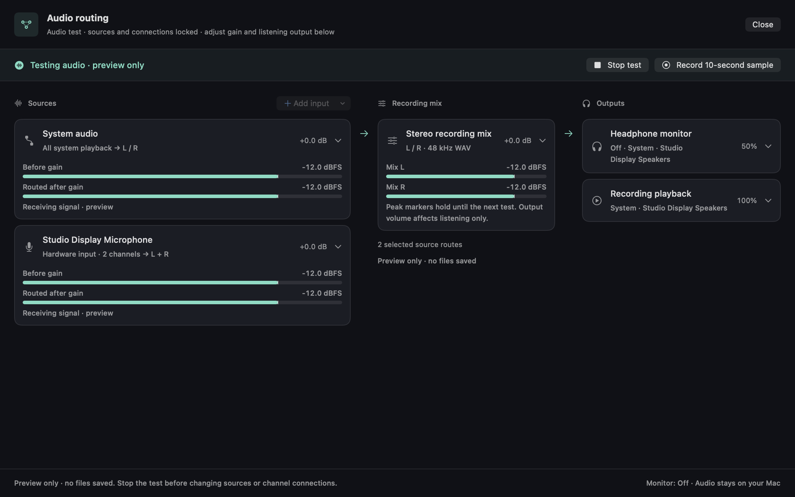

# Test audio before recording (#27)

Open **Audio Routing** in multiple-input + playback mode and choose **Test
audio**. Opening the window alone never starts capture. The preview uses the
same selected sources, timestamp alignment, channel routes, gain ramps and
mixing as a normal recording, with no WAV writers, session manifests or
transcription jobs. Stop the test to change sources or channel connections.
Gains, channel trims and mute remain live.

Source cards show **Before gain** and **Routed after gain** peak levels; expand
the card's live channel disclosure for individual channels. Disconnected mix
channels contribute zero after routing. The mix card shows independent L/R
peaks after master gain, before PCM clipping. Peak markers hold until the next
test. Missing data, silence, source failure, mute and clipping have distinct
labels, visible even when controls are collapsed. UI snapshots refresh at 10 Hz;
current bars clear after 400 ms without an update. Stopped tests retain clearly
labelled last readings and peak holds.

Use **Headphone monitor** explicitly to listen live. Its app volume, mute and
selected device remain independent from recording gain and from **Recording
playback**. Existing loopback/feedback protections still apply. No test tone
plays automatically, and the workflow never changes a system default device,
system hardware volume or another application's meeting settings. Hardware
controls remain explicit advanced user actions.

## A real, short sample

1. Choose **Record 10-second sample**. A running preview stops first; a fresh
   capture writes the stereo mix and the selected original source tracks using
   the real session writers. The common host-clock timeline, including any
   startup silence, is capped at ten seconds. **Stop sample** can finish sooner.
2. Capture and live monitoring stop and release their devices. The sample is
   verified on a utility worker before **Play sample** becomes available.
3. Play through the shared file-backed transport. The **Recording playback**
   output controls determine listening volume/mute/device. Fader edits now
   affect the next take; they do not alter the sample already saved.
4. **Keep sample** copies the verified mix, source files and their manifests
   into the configured recording folder. It refreshes the library without
   enqueueing transcription or conversion. **Discard**, closing the routing
   window, or quitting removes the temporary sample. Keep failures leave the
   temporary sample available for retry and roll back files copied by that
   attempt.

Silence caused by mute is playable and is described by the meters. Missing or
failed sources produce coverage warnings beside the sample; they do not hide
successful playback capture. A sample with no verified mix frames is rejected.
Write/finalize failures remain visible, independently of coverage warnings.

## Resource and lifecycle bounds

Only one temporary sample can be pending. A UUID scratch directory under
`$TMPDIR/com.moreaki.recscribe-audio-tests` has owner-only permissions and UUID
filenames; nothing enters the regular library before Keep. Each source and the
mix have a hard 480,000-frame, 48-kHz PCM16 limit. With eight 32-channel inputs
plus stereo playback and stereo mix, PCM payload is at most 249,600,000 bytes
(about 238 MiB), plus bounded manifests and WAV headers. Discard/failure/close
remove the active scratch directory. After a crash, directories older than 24
hours are pruned when the next sample starts; recent orphaned samples can remain
until that cleanup. Preview stops automatically after ten minutes and retains
no audio history.

The existing capture queue admits at most 4 MiB/256 PCM packets, followed by
the fixed one-second stereo mixing ring and per-source normalizers/pending
buffers (up to 250 ms, 32 channels each). Meter snapshots retain only current
and held peaks, up to 32 channels per selected source. A shared main-actor gate
excludes competing normal/test capture. Single-flight startup and teardown
wait for configuration cancellation, capture cleanup, queue drain and monitor
shutdown. Normal recording requests stop preview/sample capture and sample
playback first, then start the ordinary recording pipeline.

## Validation

Synthetic tests decode actual saved WAV samples to check gain/mute/routing,
the duration cap and unchanged original-source samples. Lifecycle tests cover
preview without files, explicit/automatic stop, real playback loading without
audible activation, Keep/Discard/close, empty samples, partial-source failure,
permission failure, capture exclusion and cancellation during suspended setup.
Native UI tests render the production views offscreen at 1120 and 760 points
using synthetic PCM and isolated settings. These checks acquire no microphone
or playback capture and enable no output.

Local validation on 2026-10-15: the full functional suite passed (466 Swift
Testing tests plus 2 XCTest tests). After the final drain-error handling change,
82 focused functional tests passed; 14 audio-test/capture lifecycle tests passed
under Thread Sanitizer with no race reports. A signed Release build passed and
its signature verified. Physical-device and audible output checks remain open.

Opt-in snapshots:

```sh
TEST_RUNNER_AUDIO_TEST_SNAPSHOTS=/tmp/recscribe-audio-test-ui xcodebuild test \
  -project RecScribe/RecScribe.xcodeproj -scheme RecScribe \
  -destination 'platform=macOS' CODE_SIGNING_ALLOWED=NO \
  -parallel-testing-enabled NO -only-testing:RecScribeTests/AudioTestViewTests
```



[Sample ready](design-proposals/audio-routing/native/audio-sample-ready.png) ·
[Narrow sample view](design-proposals/audio-routing/native/audio-sample-ready-narrow.png)

Human acceptance remains necessary: with headphones and explicit interaction,
test the selected physical input(s) and application/system playback, watch
gain/mute and clipping, listen at two monitor/output volumes, record/play a
sample, unplug an input and confirm coverage warnings, close during capture,
and start a normal recording after a test. Check keyboard activation and
VoiceOver meter labels/values. Meeting audio and device settings must be left
alone until the user chooses to test them.
